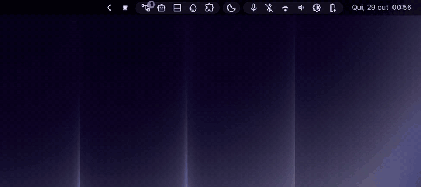
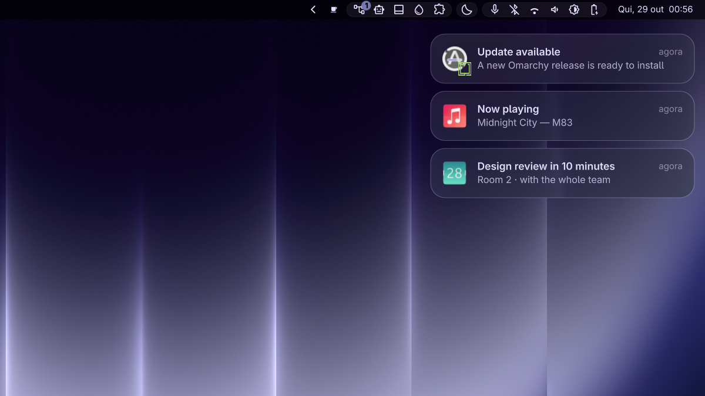

<div align="center">

# Glass Notifications

**Notifications that feel like a Mac.**
Banners slide in from the edge, stack up, and glide out of the way, on real glass.



</div>



## Why this one

- 🪟 **macOS-style banners**: app icon, title, body and time on a rounded card,
  newest on top.
- 🎢 **Motion that feels physical.** New banners spring in from the right edge,
  the rest glide down to make room, dismissed ones slide back out.
- 🧊 **Real Liquid Glass** behind each card when the
  [Liquid Glass](https://github.com/fasi96/omarchy-liquid-glass) plugin is
  installed. Without it, the cards switch to a solid plate so text stays readable.
- 🔁 **Drop-in replacement** for Omarchy's built-in notifications. It is built on
  the official `omarchy.notifications` plugin, so history, Do Not Disturb, actions,
  `omarchy-notification-send` glyphs, images and urgency all keep working, and
  your history carries over.
- ↩️ **Undo in one command.** Disable it and Omarchy's own notifications come
  straight back.

## Install

```bash
omarchy plugin add https://github.com/hugorolimf/omarchy-notifications --enable
omarchy-restart-shell
```

Enabling it switches off Omarchy's built-in notifications automatically (only one
notification daemon can run). Send yourself one to try:

```bash
notify-send -a Music -i multimedia-audio-player "Now playing" "Midnight City — M83"
```

## Liquid Glass

With the Liquid Glass plugin loaded, Glass Notifications writes
`~/.local/state/omarchy/toggles/hypr/hugorolimf-notifications-glass.lua`, which
Omarchy loads on every Hyprland reload, to put glass on the notification layer
only. Delete it and run `hyprctl reload` to turn the glass off. HyprGlass builds
with the `soft_edge` option get perfectly smooth rounded corners; others cut the
glass at an alpha threshold.

## Requirements

- Omarchy with the Quattro shell (Quickshell).
- Optional: [Liquid Glass](https://github.com/fasi96/omarchy-liquid-glass).

No packages are installed and no system file is touched.

## Remove

```bash
omarchy plugin remove io.github.hugorolimf.notifications
rm -f ~/.local/state/omarchy/toggles/hypr/hugorolimf-notifications-glass.lua && hyprctl reload
omarchy-restart-shell
```

Omarchy's built-in notifications are restored when the plugin is disabled.

## Credits

Built on Omarchy's own `omarchy.notifications` plugin by David Heinemeier Hansson
and the [Omarchy](https://github.com/basecamp/omarchy) contributors (MIT). The
notification service, history and Do Not Disturb are theirs; the banner design,
animations and glass are this plugin's.

## Pairs well with

[Glass Dock](https://github.com/hugorolimf/omarchy-dock) and
[Glass Alt+Tab](https://github.com/hugorolimf/omarchy-alttab): same material, so
the three read as one.

## License

[MIT](LICENSE)
